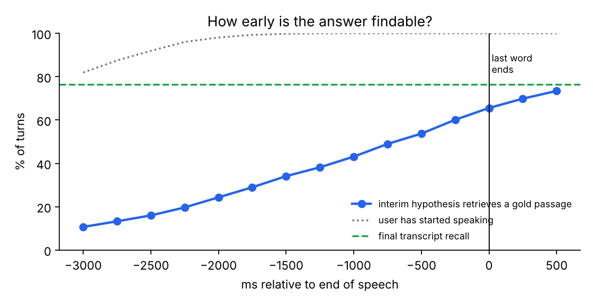
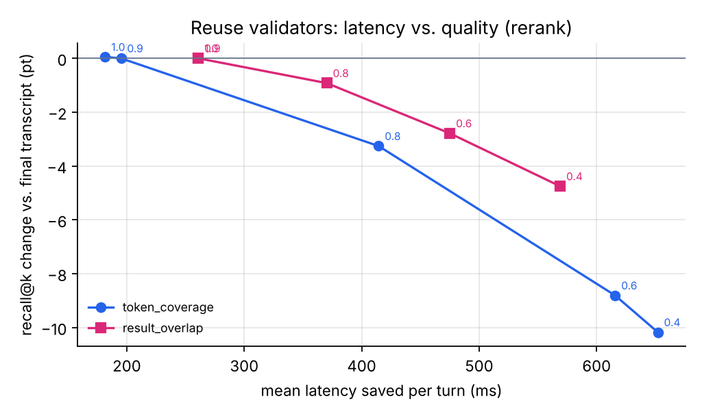
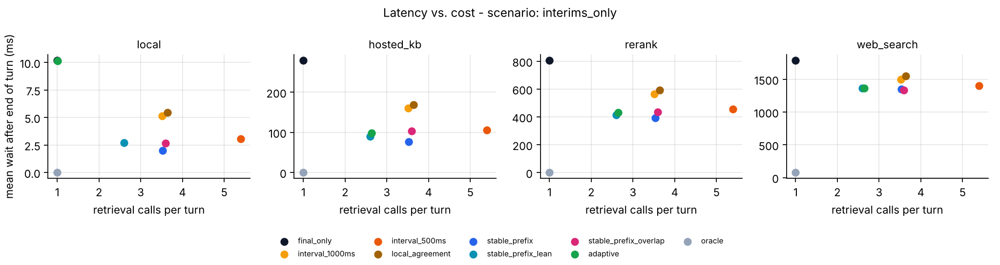

<div align="center">

# forehear

**Look-ahead retrieval for voice agents.**
Start RAG while the user is still talking, cancel the guesses that turn out wrong,
and have context ready the moment they stop.

[](https://github.com/sagarthegreat/Infinity/actions/workflows/ci.yml)


</div>

Voice agents that answer from documents retrieve **after** the user stops
talking. The lookup (embedding call, vector database, reranker, web search)
sits on the critical path of every turn, while the speech recogniser has been
streaming its best guess of the question for seconds. forehear runs retrieval
on those guesses, validates the best one against the final transcript, and
hands the LLM context that is usually already there.

```text
$ forehear replay --index 1 --policy stable_prefix --profile rerank   # a real recording, real streaming ASR
    2400 ms  interim           "what didn't like her"                 <- the recogniser stumbles...
    2900 ms  interim           'what did microsoft'                   <- ...and revises itself
    4300 ms  speculate #1 'what did microsoft announced that it would rename'           (~514 ms, GOLD)
    4800 ms  speculate #2 'what did microsoft announced that it would rename one'       (~1207 ms, GOLD)
    5000 ms  speculate #3 'what did microsoft announced that it would rename one drive' (~666 ms, GOLD)
    5666 ms  result    #3
    5700 ms  speculate #4 '... rename one drive for business'                           (~870 ms, GOLD)
    6110 ms  end_of_turn       'what did microsoft announced that it would rename one drive for business to'
    6110 ms  cancel    #4
    6110 ms  DELIVER   reused #3, wait 0 ms, top-5 GOLD

without look-ahead the wait would have been 770 ms
```

## Results

Benchmarked on **4,018 questions read aloud by people**, streamed through a real
streaming recogniser, with retrieval over 19,831 passages. Every number below is
deterministic and reproduced by `forehear bench` in a few minutes on a laptop
([full results](results/RESULTS.md), [method](docs/benchmark.md)).

**Most speech stacks give you interim transcripts and a final end of turn**
(Deepgram Nova, AssemblyAI, Google, AWS, Whisper-based). Mean time from end of
turn until retrieved context is ready:

| retrieval path (median latency) | retrieve after end of turn | **forehear** (`stable_prefix`) | ready at end of turn | calls / turn | recall@5 Δ |
|---|---:|---:|---:|---:|---:|
| hosted vector DB (250 ms) | 280 ms | **76 ms** (−73%) | 67% | 3.5 | −2.9 pt |
| + reranker (750 ms) | 806 ms | **392 ms** (−51%) | 35% | 3.5 | −3.3 pt |
| web search / tool (1.6 s) | 1,790 ms | **1,347 ms** (−25%) | 9% | 3.5 | −2.0 pt |
| in-process index (8 ms) | 10 ms | 2 ms | 80% | 3.5 | −1.3 pt |

**If your stack has an eager end-of-turn signal** (Deepgram Flux, LiveKit
preflight, Pipecat eager strategies), retrieving on it is today's best option,
and the bar forehear has to beat:

| retrieval path | after end of turn | on eager EOT | **forehear** (`stable_prefix`) | **forehear** (`adaptive`) |
|---|---:|---:|---:|---:|
| hosted vector DB | 280 ms | 45 ms · 1.1 calls | **17 ms** · 4.0 calls | 22 ms · 2.7 calls |
| + reranker | 806 ms | 507 ms · 1.1 calls | **323 ms** · 4.0 calls | 352 ms · 2.8 calls |
| web search / tool | 1,790 ms | 1,490 ms · 1.1 calls | **1,327 ms** · 4.0 calls | 1,348 ms · 2.8 calls |

What the benchmark says, including where look-ahead *doesn't* help:

* **The answer is often findable before the user finishes.** One second before
  the last word, the interim transcript already retrieves a correct passage in
  43% of turns (final transcript: 76%).
* **It pays most where the wait is longest: slow retrieval and no eager signal.**
  With an eager end-of-turn signal and a fast hosted KB, retrieving on that signal
  already gets you within ~30 ms. A local index has nothing to win;
  `Adaptive` measures that and switches itself off (1.01 calls/turn).
* **The cost is retrieval calls, not LLM calls:** about 3.5 per turn by default,
  2.6 with `stable_prefix_lean` or `Adaptive(budget=3)` for most of the savings.
  (Deepgram's eager mode costs 50-70% more *LLM* calls.)
* **Reuse has a quality price, and you choose it.** Accepting a guess that covers
  80% of the final query's content words costs about 3 points of recall@5.
  `ResultOverlap(0.8)` cuts that to under 1 point, and `ResultOverlap(0.9)` is lossless
  (on this benchmark) while still saving 261 ms per turn behind a reranker.
* **Waiting for the recogniser to "settle" loses.** Trusting only words two
  hypotheses agree on (LocalAgreement, standard in simultaneous translation)
  does worse than a plain timer. The last words of a question never get a second
  hypothesis, and they are the words retrieval needs.
* Results hold with dense retrieval ([`results/dense/`](results/dense/RESULTS.md)).

<p align="center">
  
  
</p>
<p align="center">
  
</p>

## Install

```bash
pip install git+https://github.com/sagarthegreat/Infinity           # core: zero dependencies
pip install "forehear[plots] @ git+https://github.com/sagarthegreat/Infinity"   # + figures for the benchmark
```

## Use it

```python
from forehear import Lookahead

async def search_kb(query: str) -> list[dict]:      # your existing retrieval; must be read-only
    return await vector_db.search(query, k=5)

lookahead = Lookahead(retrieve=search_kb)

# wire these to your speech-to-text callbacks
lookahead.speech_started()
lookahead.interim("can i return a damaged")
lookahead.interim("can i return a damaged item")        # retrieval starts here, in the background
delivery = await lookahead.end_of_turn("can i return a damaged item for a refund")

delivery.docs        # context for the LLM, usually ready with zero wait
delivery.reused      # True if it came from a guess made while the user was talking
delivery.wait_ms     # latency retrieval added to this turn
```

Run `python examples/quickstart.py` for a self-contained demo (no keys, no audio).

### Pipecat

```python
from forehear import Lookahead
from forehear.integrations.pipecat import lookahead_processors

tap, inject = lookahead_processors(Lookahead(retrieve=search_kb))
pipeline = Pipeline([
    transport.input(), stt, tap,              # tap: watches interim/eager transcripts
    aggregators.user(), inject, llm, tts,     # inject: adds the context before the LLM
    transport.output(), aggregators.assistant(),
])
```

Works with Pipecat's own speculative inference (`enable_eager_end_of_turn`):
the speculative `LLMContextFrame` gets context for the eager transcript, and the
final frame reuses it without another call. Full bot: [`examples/pipecat_bot.py`](examples/pipecat_bot.py).

### LiveKit Agents

```python
from forehear import Lookahead
from forehear.integrations.livekit import LookaheadAgent, attach

class Support(LookaheadAgent):          # instead of livekit.agents.Agent
    def __init__(self):
        super().__init__(instructions="...", lookahead=Lookahead(retrieve=search_kb))

agent = Support()
attach(session, agent.lookahead)        # feeds interim transcripts from the AgentSession
await session.start(agent=agent, room=ctx.room)
```

Full agent: [`examples/livekit_agent.py`](examples/livekit_agent.py).
Both adapters are tested against the real frameworks in CI.

### Tuning

| knob | default | what it does |
|---|---|---|
| `policy` | `StablePrefix()` | when to guess: every hypothesis with 3+ content words and a new one |
| `policy=Adaptive(budget=3.0)` | | holds calls/turn under a budget; turns itself off when retrieval is already fast |
| `validator` | `TokenCoverage(0.8)` | when a guess may stand in for the final query |
| `validator=ResultOverlap(probe, threshold=0.8)` | | reuse only if a cheap first stage returns the same top-k: about 1/3 of the recall loss for most of the savings |
| `max_inflight` | `2` | concurrent guesses; the oldest is cancelled when a better one arrives |
| `hedge` | `False` | if the best guess is still running at end of turn, also start a fresh call and use whichever wins |

Speculative calls are discarded all the time, so route only **read-only**
retrieval through forehear, never bookings, writes or memory updates.

## The benchmark

There was no open way to measure this, so forehear ships one. It uses **real
human speech, real streaming-ASR revisions and real retrieval**, and is
deterministic and CPU-only:

* 4,018 questions **read aloud by people** (HeySQuAD), streamed through
  Vosk in 100 ms chunks. Every interim hypothesis is recorded, including
  revisions such as "what didn't like her" → "what did microsoft".
* Retrieval over all 19,831 SQuAD v2 paragraphs (BM25, or dense with `--retriever dense`).
* The production `Controller` replayed on a virtual clock, with latency profiles
  fitted to published measurements and paired draws across policies.
* Metrics borrowed from hardware prefetching (coverage, accuracy, lateness),
  plus cost (calls/turn) and quality (recall@k vs. the final transcript).

```bash
forehear bench                      # full matrix, a few minutes, writes results/
forehear replay --index 42          # millisecond timeline of one turn
```

Methodology, metrics and limitations: [`docs/benchmark.md`](docs/benchmark.md).
Bring your own traces: [`data/README.md`](data/README.md).

## How it works

```
 STT / turn detector ──events──▶ Controller (sans-IO state machine) ──actions──▶ runtime or simulator
   SPEECH_START, INTERIM,          ├─ Policy:    "fire now, with this query"      Start / Cancel / Deliver
   EAGER_END_OF_TURN,              └─ Validator: "may this result stand in
   TURN_RESUMED, END_OF_TURN                      for the final query?"
```

The controller does no I/O: it turns timestamped events into `Start`,
`Cancel` and `Deliver` actions. The asyncio runtime executes those for real,
and the benchmark executes them on a virtual clock, so **what you benchmark is
what you ship**. Design notes, and how to write your own policy:
[`docs/design.md`](docs/design.md).

## Prior art

A literature and code review is in [`docs/research/`](docs/research/landscape-review.md). In short:

| | retrieval on partial speech | open code | open benchmark | waste reported |
|---|---|---|---|---|
| Stream RAG (Meta/CMU, 2025) | ✅ web search / KG | promised | AudioCRAG (partial) | ❌ |
| "When does streaming tool use help?" (2026) | ✅ analysis (CRAG) | ❌ | ❌ | bound only |
| Hiding tool latency on-device (2026) | ✅ tool calls | ❌ | ❌ | ❌ |
| LiveKit preemptive generation / Pipecat speculative inference | ❌ (LLM only) | ✅ | ❌ | ❌ |
| EVA-Bench (ServiceNow, 2026) | ❌ (lists speculation as a limitation) | ✅ | ✅ end-to-end | ❌ |
| **forehear** | ✅ any retriever | ✅ | ✅ real speech + real ASR | ✅ |

## Roadmap

* Multi-turn spoken dialogue traces (DSTC10 Track 2) and more ASR engines
  (Deepgram, AssemblyAI, Whisper-streaming, Parakeet).
* Learned policies: predict "the query has converged" from the hypothesis stream.
* Query completion: retrieve for the *predicted* end of the sentence, not the prefix.
* An end-to-end run inside EVA-Bench (needs API keys; contributions welcome).

## Contributing, citing, license

Contributions are very welcome, especially new policies with benchmark results:
see [CONTRIBUTING.md](CONTRIBUTING.md). To cite forehear, use
[CITATION.cff](CITATION.cff). Code is Apache-2.0; benchmark data keeps its
upstream licenses (HeySQuAD CC BY 4.0, SQuAD CC BY-SA 4.0), see [NOTICE](NOTICE).
